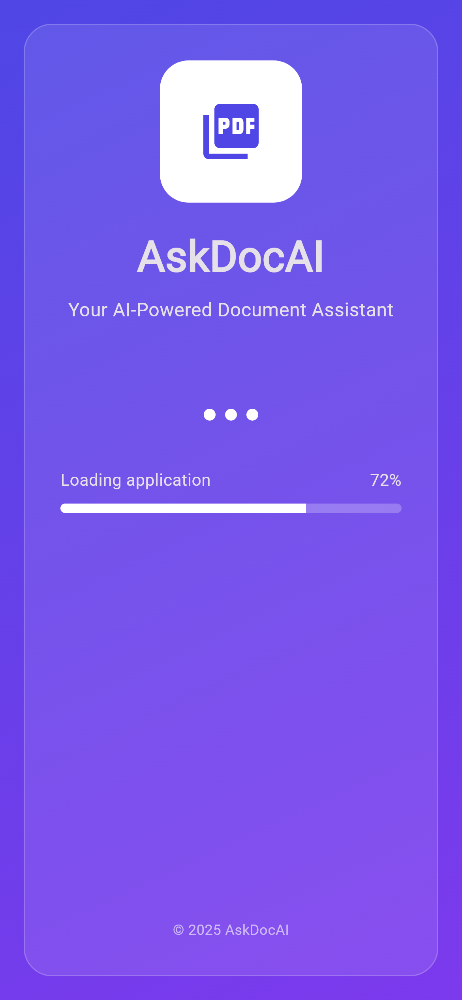
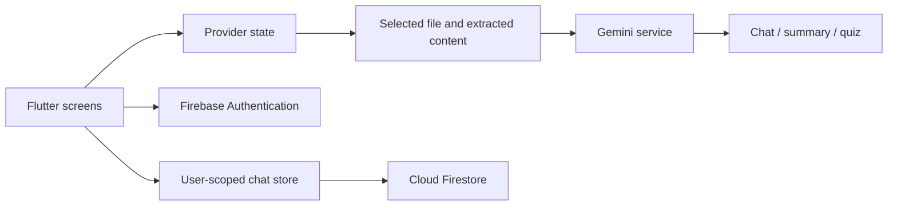

# AskDocAI

Flutter document upload, chat, summaries, and quizzes with Firebase authentication.
The app is ad-free, uses email/password and Google Sign-In, and has a navy-and-blue Material 3 theme.
Android is the primary development target. Web, Windows, Linux, and macOS projects
are retained; see the validation report for platform-specific limitations. iOS
project support has been removed.

## Mobile interface preview

The launch experience introduces AskDocAI as an AI-powered document assistant before users enter its upload, chat, summary, and quiz workflows.

<p align="center">
  
</p>

## Features and stack

- Document selection and text extraction for chat, summaries, and quizzes.
- Provider/ChangeNotifier state for files, document content, summaries, language, and authentication.
- Gemini integration through `google_generative_ai`.
- Email/password and Google Sign-In with Firebase Authentication.
- User-scoped chat persistence in Cloud Firestore.
- Seven configured interface locales and an ad-free Material 3 interface.

Dependencies include `file_picker`, `doc_text_extractor`, `provider`, `cloud_firestore`, and the Firebase SDKs. [pubspec.yaml](pubspec.yaml) declares Dart `^3.9.2`; the validated development versions are recorded below.

## Architecture



`lib/main.dart` initializes Firebase and composes providers. `lib/providers/` holds observable app/document state, `lib/utils/gemini_service.dart` wraps AI requests, and `lib/services/chat_store.dart` persists chat exchanges below the authenticated user's conversation path. The Gemini service currently selects `gemini-2.5-pro`; provider access/model availability must be verified with your own account.

The current design passes document content into model requests. It does not demonstrate a separate vector database or server-side retrieval service.

## Repository map

| Path | Responsibility |
| --- | --- |
| `lib/Auth/`, `lib/providers/auth_state.dart` | Account operations and auth state |
| `lib/providers/` | Files, summaries, document content, language |
| `lib/screens/` | Home/upload, chat, summary, quiz, sign-in |
| `lib/utils/` | Text extraction helpers, AI calls, theme |
| `lib/services/chat_store.dart` | Firestore chat persistence |
| `test/` | Auth UI, chat persistence, and feature checks |
| `docs/` | Setup and prior validation reports |

## Android development

Use Flutter 3.38.9 / Dart 3.10.8 (validated host), Android SDK 36, and Android
Studio's bundled JDK 21. The project pins AGP 8.9.1, Gradle 8.12, and Kotlin 2.1.0.
Do not use the host's standalone Java 25 for direct Gradle commands.

```powershell
flutter pub get
flutter analyze
flutter test
flutter build apk --debug
flutter devices
flutter run -d <authorized-device-id>
```

AI features need your own Gemini key. Create an ignored `config.local.json`:

```json
{"API_KEY": "YOUR_GEMINI_API_KEY"}
```

```powershell
flutter run -d <authorized-device-id> --dart-define-from-file=config.local.json
```

The app starts without an AI key and reports missing setup when AI is requested.
An existing `.env` is preserved, but is no longer a mandatory bundled asset.
For legacy dotenv loading, explicitly register your local `.env` under Flutter
assets; prefer the ignored JSON file and Dart defines for repeatable builds.
Keys embedded in a client build are extractable; use a backend before production.

The Dart package is `askdocai`; Android/macOS/Linux identifiers use
`com.example.askdocai`. Firebase uses the existing project `askdocai-b699d` with
registered Android, web/Windows, and macOS apps. Email/password sign-in, account
creation, and password reset are available alongside Google Sign-In. Android
debug signing fingerprints are registered; release certificates still need to
be registered when release signing is configured. See
[package rename and Firebase setup](docs/PACKAGE_RENAME_AND_FIREBASE_SETUP.md).

## Change and validation records

- [Package rename and Firebase backend setup](docs/PACKAGE_RENAME_AND_FIREBASE_SETUP.md)
- [Ad-free blue theme refactor](docs/AD_FREE_THEME_REFACTOR.md)

- [Android migration report](docs/ANDROID_MIGRATION_REPORT.md)
- [Individual file staging guide](docs/FILE_BY_FILE_GIT_GUIDE.md)

Release signing still requires owner configuration.

## Demo and verification scope

On a configured development project, sign in, select a small nonconfidential document, ask a document-specific question, generate a summary, and complete a quiz. Reopen a saved conversation and check language switching. Verify missing-key and network-error behavior separately.

Document content can be sent to the configured AI provider. Review Firestore rules and user isolation before using real client documents. AI responses can be incorrect; a generated answer or quiz is not a verified source.

The commands and prior reports above distinguish setup instructions from historical validation. This documentation update does not assert that builds, external APIs, or Firebase acceptance checks were rerun.
